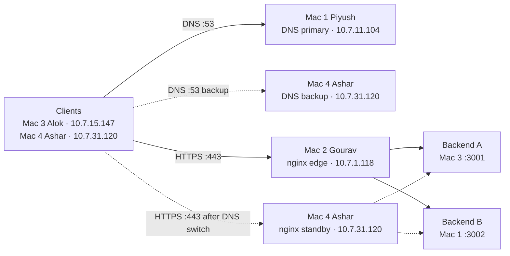
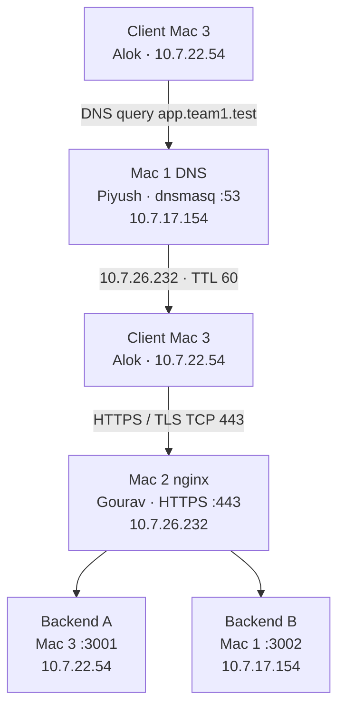

# Team 1 — Private DNS, HTTPS/TLS, Reverse Proxy, Load Balancing, HTTP Caching and Packet Analysis

## Overview

Team 1 built a private web service on one Wi-Fi LAN. A private DNS server publishes two hostnames. An edge Mac terminates HTTPS, speaks HTTP/2, and reverse-proxies requests to two backends with round-robin load balancing and failover. The backends support HTTP caching with `Cache-Control` and `ETag` validation. Packet captures on the client Mac show DNS, the TCP handshake, and TLS.

The project has two phases:

- **Phase 1 — Build and Observe** (October 2026): three Macs. Built, tested and documented below. Its results use the addresses the Macs had then.
- **Phase 2 — Harden and Recover** (from 25 Nov 2026): Ashar Shaikh joined with a fourth Mac, which adds a backup DNS server and a standby edge. Wi-Fi gave every Mac a new address, so Phase 1 was rebuilt first. Status is in [Phase 2](#phase-2--harden-and-recover). Who did what and each person's script are in [TEAM-WORK-LOG.md](TEAM-WORK-LOG.md).

This repository holds the architecture notes, the configuration that was used, the backend program, the team scripts, and the lab evidence that was retained. The index is [04-Evidence/EVIDENCE-INDEX.md](04-Evidence/EVIDENCE-INDEX.md). A file is marked available only when it is in the tree. Tests whose original screenshots were not kept are marked not retained. The written report in `docs/` is not packet evidence.

## Team members and roles

| Person | Machine | Phase 1 roles | Phase 2 roles | Script |
| --- | --- | --- | --- | --- |
| Piyush | Mac 1 | Private DNS server and Backend B | Primary DNS, TTL change and DNS switch, firewall on port 3002 | [piyush-mac1.sh](03-Source-Code/team/piyush-mac1.sh) |
| Gourav | Mac 2 | Edge server, nginx reverse proxy, round-robin load balancer, TLS/HTTPS termination | Primary edge, failover demo, certificate owner | [gourav-mac2.sh](03-Source-Code/team/gourav-mac2.sh) |
| Alok | Mac 3 | Backend A, test client, Wireshark packet capture | Backend A, firewall on port 3001, client side of every demo, fault diagnosis | [alok-mac3.sh](03-Source-Code/team/alok-mac3.sh) |
| Ashar Shaikh | Mac 4 | — (joined in Phase 2) | Backup DNS, standby edge nginx, second client, Phase 2 report | [ashar-mac4.sh](03-Source-Code/team/ashar-mac4.sh) |

## Submission type

**Phase 1: Type 2 — 2 or 3 Macs with combined roles.**

Three physical Macs share the work. Mac 1 runs DNS and Backend B. Mac 3 runs Backend A, the test client, and Wireshark. Mac 2 is only the edge.

In Phase 2 a fourth Mac (Mac 4) is added for redundancy. The Phase 1 roles stay on Macs 1–3.

## Architecture

### Phase 2 (current, addresses from 26 Nov 2026)



Dashed lines are the backup paths. Every edge response carries `X-Edge: mac2` or `X-Edge: mac4`, so a test shows which edge answered.

### Phase 1 (as tested, October 2026 addresses)



The client never opens HTTP directly to ports 3001 or 3002 for the public names. Those ports are the upstream targets used by nginx on the LAN.

Full addressing, interface, and MAC details are in [01-Architecture-Document/README.md](01-Architecture-Document/README.md).

## Machine and IP table

Network: `10.7.0.0/19`  
Gateway: `10.7.0.1`  
Subnet mask on every Mac: `255.255.224.0`  
Interface on every Mac: `en0`

The addresses come from Wi-Fi DHCP and change between lab days. The current ones are in [03-Source-Code/team.env](03-Source-Code/team.env), which every script reads. Check with `ipconfig getifaddr en0` at the start of each session.

| Machine | Person | IP now (26 Nov 2026) | IP in Phase 1 | MAC address | Services |
| --- | --- | --- | --- | --- | --- |
| Mac 1 | Piyush | 10.7.11.104 | 10.7.17.154 | 10:9f:41:c0:9e:e5 | dnsmasq UDP/TCP 53 (primary), Backend B TCP 3002 |
| Mac 2 | Gourav | 10.7.1.118 | 10.7.26.232 | e6:09:91:27:22:3b | nginx HTTPS 443, TLS 1.2 and TLS 1.3, HTTP/2 (primary edge) |
| Mac 3 | Alok | 10.7.15.147 | 10.7.22.54 | 72:36:67:c5:54:98 | Backend A TCP 3001, curl/dig, Wireshark on en0 |
| Mac 4 | Ashar Shaikh | 10.7.31.120 | — | not recorded yet | dnsmasq (backup), nginx HTTPS 443 (standby edge), second client |

## Phase 1 — as built and tested

The sections from here to [Test results](#test-results) record Phase 1. They use the Phase 1 addresses, because those are what the tests and captures showed. For today's addresses use the table above.

## Request flow

1. Mac 3 asks Mac 1 (`10.7.17.154`) for `app.team1.test`.
2. dnsmasq answers with `10.7.26.232` and a TTL of 60 seconds. `api.team1.test` uses the same address.
3. Mac 3 opens TCP port 443 on Mac 2. The handshake is SYN, SYN-ACK, ACK.
4. Mac 2 presents the server certificate for `app.team1.test`, issued by Team1 Local CA. The certificate also lists `api.team1.test` as a subject alternative name.
5. nginx terminates TLS and proxies the request over plain HTTP to Backend A (`10.7.22.54:3001`) or Backend B (`10.7.17.154:3002`).
6. The chosen backend sets `X-Backend: A` or `X-Backend: B`. nginx returns that response on the existing HTTPS connection.

## DNS architecture

Mac 1 is the only resolver that knows the team names. The client Macs use `10.7.17.154` as their DNS server.

| Name | Type | Address | TTL |
| --- | --- | --- | --- |
| app.team1.test | A | 10.7.26.232 | 60 |
| api.team1.test | A | 10.7.26.232 | 60 |

dnsmasq is configured with `domain-needed`, `bogus-priv`, and `no-resolv`. Unknown names are forwarded to `8.8.8.8` and `1.1.1.1`. Queries are logged to `/tmp/dnsmasq.log`. The file is [02-Configuration-Bundle/dns/dnsmasq.conf](02-Configuration-Bundle/dns/dnsmasq.conf).

A resolver that does not have these records, such as `8.8.8.8`, returns NXDOMAIN for `app.team1.test`.

## Backend architecture

Both backends run [03-Source-Code/backend/server.py](03-Source-Code/backend/server.py).

| Backend | Host | Listen address |
| --- | --- | --- |
| A | Mac 3 (Alok) | 10.7.22.54:3001 |
| B | Mac 1 (Piyush) | 10.7.17.154:3002 |

| Method and path | Behavior |
| --- | --- |
| `GET /` | Short JSON greeting that names the backend |
| `GET /api/status` | JSON identity and status, plus `X-Backend: A` or `X-Backend: B` |
| `GET /api/cached` | JSON body with `Cache-Control: max-age=60` and an `ETag` |

The cached document is the same on A and B, so the `ETag` does not change when the load balancer switches backends. `X-Backend` still identifies which process answered.

## nginx reverse proxy

Mac 2 runs nginx 1.31.6. The site file copied from `/opt/homebrew/etc/nginx/servers/team1.conf` is [02-Configuration-Bundle/edge/nginx-servers-team1.conf](02-Configuration-Bundle/edge/nginx-servers-team1.conf).

- `listen 443 ssl` and `http2 on`
- `server_name app.team1.test api.team1.test`
- TLS certificate and private key paths point at the files on Mac 2
- `ssl_protocols TLSv1.2 TLSv1.3`
- `proxy_pass http://backends` for `/`
- `Host`, `X-Real-IP`, and `X-Forwarded-For` are forwarded
- `proxy_connect_timeout 2s` and `proxy_next_upstream error timeout http_502`

nginx decrypts the client request and opens a new HTTP connection to the selected backend. Clients do not see ports 3001 and 3002.

## Round-robin load balancing

The upstream block lists Backend A first and Backend B second, with no explicit weights, so nginx uses its default round-robin policy:

```
10.7.22.54:3001
10.7.17.154:3002
```

Each upstream has `max_fails=1` and `fail_timeout=10s`. If a backend does not accept a connection, nginx marks it unavailable and sends the request to the other one.

The final verified series was six consecutive HTTPS requests. `X-Backend` came back A, B, A, B, A, B. No screenshot of that series was saved. The nginx file is the retained record of the two-backend pool.

## TLS and HTTPS

Team1 Local CA is a local root created on Mac 2. It signed a server certificate whose subject is `app.team1.test` and whose subject alternative names are:

- `DNS:app.team1.test`
- `DNS:api.team1.test`

The CA certificate was added to the System keychain on all three Macs, so `curl` verifies the chain without `-k`. Public certificates are in [03-Source-Code/edge/ca-public](03-Source-Code/edge/ca-public). The setup steps are in [02-Configuration-Bundle/edge/TLS-SETUP.md](02-Configuration-Bundle/edge/TLS-SETUP.md).

`teamCA.key` and `app.key` stay on Mac 2. They are not part of this repository.

## HTTP/2

nginx advertises HTTP/2 on port 443 (`http2 on`). Successful HTTPS requests to `https://app.team1.test/api/status` were completed with HTTP/2.

## HTTP caching

`GET /api/cached` returns:

- `Cache-Control: max-age=60`
- an `ETag` for the cached JSON document

A follow-up request that sends that value in `If-None-Match` receives `304 Not Modified` and an empty body.

The final live response from `https://app.team1.test/api/cached` was HTTP/2 200 from nginx 1.31.6, `content-type: application/json`, `content-length: 51`, `x-backend: B`, `cache-control: max-age=60`, and `etag: "a8975e0e7afcd001cfc2938f7a0feecb"`. That header transcript was not saved as a file. This observed ETag is the live result. The checked-in `server.py` also sends `Cache-Control: max-age=60` and an ETag, and it returns 304 when `If-None-Match` matches, but its cached document is a different body, so its ETag is not that live value.

An older access log, from 4 Oct 2026, records `GET /api/cached HTTP/2.0` status `200` at 01:58:33 and status `304` at 01:59:10. The client address in that log is the capture-time address `10.7.4.38`. The log does not store `Cache-Control` or `ETag`. The file is [04-Evidence/F-HTTP-Caching/mac2_nginx_access.log](04-Evidence/F-HTTP-Caching/mac2_nginx_access.log).

## Wireshark packet analysis

The final live test on Mac 3 (`en0`) showed:

1. DNS query `10.7.22.54` to `10.7.17.154` UDP/53 for `app.team1.test` A.
2. Response `10.7.26.232`, TTL 60.
3. TCP handshake `10.7.22.54:58709` to `10.7.26.232:443`: SYN, SYN-ACK, ACK.
4. ClientHello with SNI `app.team1.test`, TLS 1.3 negotiated.
5. Later HTTP was encrypted TLS Application Data.

No packet file of that test was saved.

The file `phase1_full_flow.pcapng` and the screenshots in [04-Evidence/G-Packet-Capture](04-Evidence/G-Packet-Capture) are historical. Their DHCP addresses are capture-time values: client `10.7.4.38`, edge `10.7.18.35`, DNS `10.7.17.154`. That capture shows the same stages — DNS answer, TCP handshake, ClientHello SNI, a TLS 1.2 certificate from Team1 Local CA, and encrypted Application Data. TLS 1.3 encrypts the Certificate message, so the issuer and subject were read from the TLS 1.2 handshake in that older capture.

## Failure scenarios

`dig @8.8.8.8 app.team1.test` returned NXDOMAIN in the final test. No screenshot was saved.

An earlier wrong-record test temporarily answered `10.7.31.250` and the HTTPS connection timed out. The record was restored. The checked-in `dnsmasq.conf` answers `10.7.26.232`. No screenshot of that test was saved.

An earlier wrong-port test to `https://app.team1.test:4443` resolved and then returned `Connection refused`. No screenshot was saved. The historical notes of that test used the capture-time edge address `10.7.18.35`.

Older nginx logs in [04-Evidence/H-Failure-Scenarios](04-Evidence/H-Failure-Scenarios) are historical. At 01:52:30 they show a refused connection to capture-time Backend A `10.7.4.38:3001` while the access log recorded HTTP/2.0 `200`. Around 01:56 both `10.7.4.38:3001` and `10.7.17.154:3002` refused connections and the access log recorded HTTP/2.0 `502`. Those logs do not contain `X-Backend`.

## Failure Demonstration — Backend A Failover

Before failure, six requests returned `x-backend` A, B, A, B, A, B.

Backend A on Mac 3 (`10.7.22.54:3001`) was stopped. During the failure, six requests returned `x-backend` B, B, B, B, B, B. nginx kept serving through the healthy backend.

Backend A was restarted. The next six requests returned B, B, A, B, A, B. Both backends were available again.

No screenshot of this demonstration was saved.

## Test results

Final live checks. A screenshot or capture was not saved for this session unless the evidence column names a file.

| # | Test | Result | Evidence in this repo |
| --- | --- | --- | --- |
| 1 | DNS resolution | `app.team1.test` resolved to `10.7.26.232` from server `10.7.17.154`, TTL 60 | Final transcript not saved. Historical pcap and G2 show the same name resolving to capture-time `10.7.18.35` |
| 2 | Public DNS isolation | `dig @8.8.8.8 app.team1.test` returned NXDOMAIN | Not retained |
| 3 | HTTPS/TLS | Verification succeeded without `-k`. SAN `app.team1.test`. Issuer Team1 Local CA. TLS 1.3. HTTP/2 200 | Final transcript not saved. Historical E1 shows verification, HTTP/2 200, and `x-backend: B` |
| 4 | Load balancing | Six requests returned `X-Backend` A, B, A, B, A, B | Configuration file only. The series was not saved |
| 5 | Backend A failover | While `10.7.22.54:3001` was stopped, six requests returned B. After restart the series was B, B, A, B, A, B | Not retained. Historical nginx logs show an earlier failover without `X-Backend` |
| 6 | HTTP caching | HTTP/2 200, `cache-control: max-age=60`, `etag: "a8975e0e7afcd001cfc2938f7a0feecb"`, `x-backend: B` | Header text not saved. Historical access log shows a `304` on `/api/cached` |
| 7 | Both backends down | Historical nginx log recorded HTTP/2.0 `502` | Available in the 4 Oct logs. Not repeated as a new file |
| 8 | Wrong port 4443 | Earlier test: name resolved, then connection refused | Not retained |

## Phase 2 — Harden and Recover

### Rebuild on 25–26 Nov 2026

Every Mac came back with a new DHCP address, so the Phase 1 setup was rebuilt on the new addresses before any Phase 2 work:

- dnsmasq on Mac 1 now answers `app.team1.test` → `10.7.1.118`. `dig` from Mac 3 returned that address.
- Backends A and B were restarted on Mac 3 and Mac 1.
- Gourav created a **new** Team1 Local CA and server certificate on Mac 2, valid from 25 Nov 2026 19:18 GMT. `openssl verify` returned `app.crt: OK`.
- nginx on Mac 2 was rewritten with the new backend addresses. From Mac 3: `SSL certificate verify ok`, TLS 1.3, `HTTP/2 200`, `x-backend: A`, `x-edge: mac2`.
- Mac 4 trusted the new CA, received the certificate for the standby edge, and passed `nginx -t`.

The ten problems met during the rebuild, each with its layer, cause and fix, are in [04-Evidence/I-Troubleshooting-Notes/README.md](04-Evidence/I-Troubleshooting-Notes/README.md).

### Extensions

✅ done and verified · 🟡 done, proof still to be taken · ⏳ to do

| Ext | What | Owner | Status |
| --- | --- | --- | --- |
| A | Backup DNS on Mac 4. Stop Mac 1's DNS and the names still resolve | Ashar | ⏳ |
| B | TTL 30 s, change a record, watch the cached answer expire, then flush | Piyush | ⏳ |
| C | Firewall: only the edges may reach ports 3001 and 3002 | Piyush (3002), Alok (3001) | ⏳ |
| D | Stop Backend A, all traffic goes to B, restart A, it returns. Name the single point of failure | Gourav | ⏳ |
| E | Standby nginx on Mac 4 and a DNS switch to it | Ashar | 🟡 nginx running, `x-edge: mac4` test pending |
| F | Evaluator injects a fault, the team diagnoses it layer by layer | Everyone | ⏳ (demo day) |

The run order, with the exact command for each person, is in section 4 of [TEAM-WORK-LOG.md](TEAM-WORK-LOG.md#4-order-of-work-for-the-rest-of-phase-2).

### Still to do before submission

- Copy the new public certificate files (`teamCA.crt`, `app.crt`, `app.csr`, `app.ext`, valid from 25 Nov 2026) from Mac 2 into the repository. The files now in `02-Configuration-Bundle/edge/` and `03-Source-Code/edge/ca-public/` are the Phase 1 ones (valid from 3 Oct 2026). Never commit the `.key` files.
- Run the Extension A–E demos and save the evidence. Each script run is saved under `04-Evidence/_runs/<date>/`.
- Take the Wireshark screenshots of the new capture `team1-flow.pcap`.
- Write the Phase 2 report (Ashar collects one paragraph per extension owner).

## Repository structure

```
.
├── README.md
├── TEAM-WORK-LOG.md          # who did what, Phase 2 owners, run order
├── .gitignore
├── 01-Architecture-Document/
│   ├── README.md
│   ├── Architecture-Document.pdf
│   ├── network-architecture.png
│   └── diagrams/
│       ├── topology.svg
│       ├── topology.png
│       ├── request-flow.svg
│       └── request-flow.png
├── 02-Configuration-Bundle/
│   ├── README.md
│   ├── team.env
│   ├── backend/BACKEND-LAUNCH.md
│   ├── dns/dnsmasq.conf
│   ├── dns/etc-resolver-team1.test
│   └── edge/
│       ├── TLS-SETUP.md
│       ├── nginx-servers-team1.conf
│       └── team1-root-ca.crt
├── 03-Source-Code/
│   ├── README.md
│   ├── team.env
│   ├── lib.sh
│   ├── backend/server.py
│   ├── common/
│   ├── dns/
│   ├── edge/ca-public/
│   └── team/                 # one script per person + common.sh
│       ├── piyush-mac1.sh
│       ├── gourav-mac2.sh
│       ├── alok-mac3.sh
│       ├── ashar-mac4.sh
│       └── common.sh
├── docs/
│   └── Team1_Computer_Networks_Project_Report.docx
└── 04-Evidence/
    ├── EVIDENCE-INDEX.md
    ├── A-LAN-Setup/
    ├── B-Private-DNS/
    ├── C-Backends/
    ├── D-Load-Balancing/
    ├── E-HTTPS-TLS/
    ├── F-HTTP-Caching/
    ├── G-Packet-Capture/
    ├── H-Failure-Scenarios/
    ├── I-Troubleshooting-Notes/README.md
    ├── _raw-extra/
    └── _runs/<date>/         # created by the team scripts, one text file per run
```

Role guides and the demo checklist are in `03-Source-Code`. Evidence status is only in [04-Evidence/EVIDENCE-INDEX.md](04-Evidence/EVIDENCE-INDEX.md). The report under `docs/` explains the project in prose and is not a substitute for the capture or the logs.

## How to reproduce

### With the team scripts (Phase 2, recommended)

1. On every Mac, run `ipconfig getifaddr en0` and put the four addresses into [03-Source-Code/team.env](03-Source-Code/team.env).
2. On each Mac, run that person's script with no arguments to see its menu:

```bash
cd 03-Source-Code/team
./piyush-mac1.sh      # Mac 1
./gourav-mac2.sh      # Mac 2
./alok-mac3.sh        # Mac 3
./ashar-mac4.sh       # Mac 4
```

3. Bring the lab up in this order: Piyush `dns-setup` and `backend`; Alok `backend`; Gourav `nginx-setup`; Ashar `dns-setup` and `nginx-setup`. Then Alok and Ashar run `use-dns both`, and Alok runs `https`, `lb`, `cache` and `test-standby`.

The full order for the Phase 2 demos is in [TEAM-WORK-LOG.md](TEAM-WORK-LOG.md#4-order-of-work-for-the-rest-of-phase-2).

### By hand (Phase 1 steps)

Use three Macs on `10.7.0.0/19` with the addresses in `team.env`. Python 3 is enough for the backends. Mac 2 needs nginx and OpenSSL. Mac 1 needs dnsmasq. Mac 3 needs `dig`, `curl`, and Wireshark.

**Mac 1 — DNS and Backend B**

```bash
cd 03-Source-Code/dns
./setup-dns.sh /opt/homebrew/etc/dnsmasq.conf
sudo dnsmasq -C /opt/homebrew/etc/dnsmasq.conf

cd ../backend
./start-backend.sh B
```

**Mac 3 — Backend A and the client**

```bash
cd 03-Source-Code/backend
./start-backend.sh A

cd ../common
./use-team-dns.sh
```

**Mac 2 — TLS edge**

Keep `app.key` beside `app.crt` on the edge Mac only. The checked-in nginx file expects:

- certificate: `/Users/gouravtanwar/cn-certs/app.crt`
- private key: `/Users/gouravtanwar/cn-certs/app.key`

Trust the CA on each Mac, then start nginx:

```bash
sudo security add-trusted-cert -d -r trustRoot \
  -k /Library/Keychains/System.keychain \
  /path/to/teamCA.crt

nginx -t
brew services start nginx
```

Point a browser or `curl` at `https://app.team1.test/api/status` from Mac 3. Do not pass `-k`.

## Useful commands

Addresses below are the current ones (26 Nov 2026). If they changed, take them from `team.env`.

```bash
dig app.team1.test
dig @10.7.11.104 app.team1.test     # primary DNS, Mac 1
dig @10.7.31.120 app.team1.test     # backup DNS, Mac 4

curl -s -D - -o /dev/null --resolve app.team1.test:443:10.7.31.120 \
  https://app.team1.test/api/status | grep -iE 'HTTP/|x-edge|x-backend'   # standby edge, Mac 4

curl -v https://app.team1.test/api/status

for i in {1..6}; do
  curl -s -D - -o /dev/null https://app.team1.test/api/status | grep -i x-backend
done

curl -s -D - -o /dev/null https://app.team1.test/api/cached | grep -iE 'HTTP/|cache-control|etag'
ETAG=$(curl -s -D - -o /dev/null https://app.team1.test/api/cached | awk -F': ' 'tolower($1)=="etag"{print $2}' | tr -d '\r')
curl -s -D - -o /dev/null -H "If-None-Match: $ETAG" https://app.team1.test/api/cached

curl -v https://app.team1.test:4443
openssl x509 -in 03-Source-Code/edge/ca-public/app.crt -noout -subject -issuer -ext subjectAltName
```

Direct backend checks, bypassing the proxy:

```bash
curl -i http://10.7.15.147:3001/api/status   # Backend A, Mac 3
curl -i http://10.7.11.104:3002/api/status   # Backend B, Mac 1
```

While the Extension C firewall is on, these direct checks time out from every Mac except the two edges.

## Security notes

- `*.key`, `teamCA.key`, and `app.key` are listed in [.gitignore](.gitignore).
- The private keys were created on Mac 2 and were not copied into this repository.
- Public files `teamCA.crt`, `app.crt`, `app.csr`, and `app.ext` are included so the certificate chain and SAN list can be inspected. The copies in the tree are still the Phase 1 ones. The CA was replaced on 25 Nov 2026 and the new public files have not been added yet.
- For the standby edge, Mac 4 holds a copy of `app.key` in `~/cn-certs`. Run `./ashar-mac4.sh cleanup` after the project to delete it.
- nginx references `app.key` by absolute path. That line is a filesystem path, not the key.
- The lab CA is a private root for `*.team1.test` on this LAN. It is not a public certificate authority.
- dnsmasq query logs on Mac 1 go to `/tmp/dnsmasq.log` and are not committed.

## Key learnings

- Name lookup, TCP connection setup, TLS, and the HTTP application are separate stages. A correct DNS answer does not mean the host is listening, and a listening host does not mean the requested port is open.
- A private zone is invisible to public resolvers. `8.8.8.8` returned NXDOMAIN for a name that Mac 1 answers locally.
- The reverse proxy gives clients one hostname and one port. Backend addresses stay on the LAN, and nginx can hide a dead upstream.
- Round-robin spreads requests. `max_fails` and `proxy_next_upstream` keep the site up when one backend stops. When both stop, TLS to nginx still succeeds and the client receives 502.
- Trust comes from the CA installed on the client, not from disabling verification. SAN entries are what allow one certificate to cover `app.team1.test` and `api.team1.test`.
- TLS 1.3 hides the Certificate message. A TLS 1.2 handshake was used to show the issuer and subject on the wire. After the handshake, Application Data is encrypted between the client and the edge.
- `Cache-Control: max-age=60` tells the client how long the response stays fresh. `ETag` plus `If-None-Match` lets the server answer `304 Not Modified` when the body has not changed.
